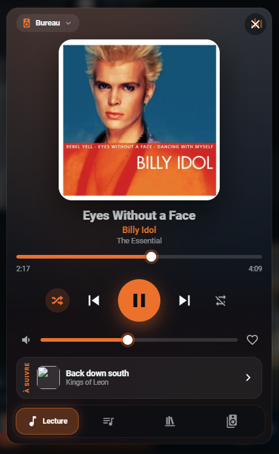
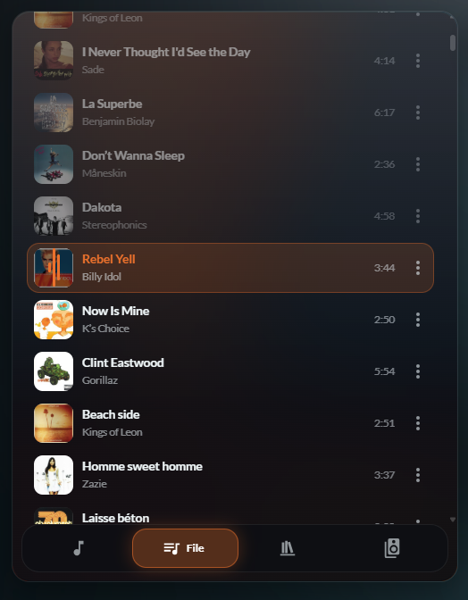
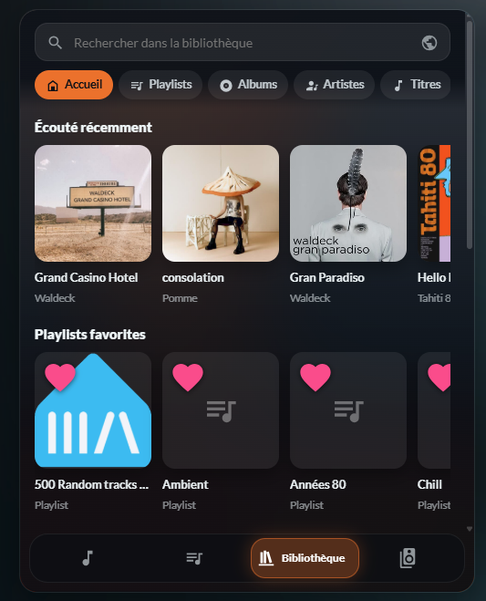
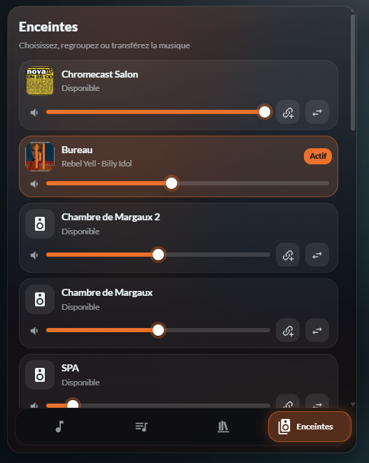
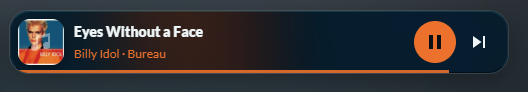
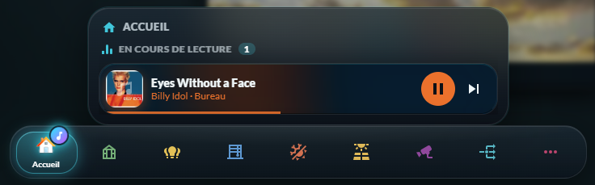

# 🎵 HOLM Music Card

[](https://hacs.xyz/)


[🇫🇷 Français](README.md) · 🇬🇧 English

**A modern Music Assistant player for Home Assistant: big artwork, colours that follow the music, your library and all your speakers in a single card.**

HOLM Music Card uses **everything [Music Assistant](https://music-assistant.io/) can do**: now playing, queue, full library with search across all your services, radio, podcasts, multiroom… The background and accent colour are **taken from the artwork**, gestures feel natural (swipe to change track, double-tap to add to favourites), and a **mini view** lets you fit it into a bar or a corner of a dashboard.

> ✨ **Zero YAML.** Add the card from the card picker, choose your player, and **every setting is in the visual editor**.

### At a glance

- 🎨 **Now playing**: square artwork or **spinning vinyl**, blurred background and accent colour **extracted from the artwork**, scrolling long titles, interactive progress bar, shuffle, repeat, favourite, volume.
- 🎤 **Lyrics** in the enlarged player, **synced** with the music when Music Assistant provides them (the sung line lights up, tap a line to jump to it).
- ➕ **Add to a playlist** the current track (or a track from the queue), choosing among your editable playlists.
- 👆 **Gestures**: swipe on the artwork = next / previous track, double-tap = favourite ♥.
- 📜 **Queue**: current and upcoming tracks, play a track, move, “play next”, remove, clear the queue, **save as playlist**.
- 📚 **Library**: home (recently played, favourites, recently added), playlists, albums, artists, tracks, radio, podcasts, audiobooks; sorting, favourites filter, album / artist / playlist pages.
- 🔎 **Global search**, in your library **and** on your streaming services.
- ▶️ **Play now, next, add to queue, replace**, or start a **radio mode** (similar tracks).
- 🔊 **Speakers**: switch player, **transfer playback** from one room to another, **group** (multiroom), volume per speaker.
- 🪟 **Mini view**: a compact bar with previous, play / pause, next and **volume** (the slider appears on tap); tapping the title opens the full player in a window.
- 🧭 Used by **[HOLM Navbar Card](https://github.com/kaaribou/holm-navbar-card)** for the mini player, the music note and the playing players.
- 🌍 **8 languages**: English, French, German, Spanish, Italian, Dutch, Portuguese and Polish.

| Now playing | Queue | Library | Speakers |
|---|---|---|---|
|  |  |  |  |

**Mini view**



*Screenshots in French — the card follows the language of your Home Assistant profile.*

### 🆕 What's new in 1.3.0

- 🌍 **The card speaks 8 languages**: English, French, German, Spanish, Italian, Dutch, Portuguese and Polish, editor included. It follows the language of your Home Assistant profile (English if your language isn't translated yet); the `language` option lets you force one.

---

## Requirements

> [!IMPORTANT]
> This card is a player **for Music Assistant only**. You need:
> - a **[Music Assistant](https://music-assistant.io/) 2.x** server (add-on or container);
> - the **Music Assistant** integration installed in Home Assistant (Settings → Devices & services);
> - **Home Assistant 2025.1** or newer.
>
> The players offered are the `media_player` entities created by the Music Assistant integration.

---

## Installation

### With HACS (recommended)

1. HACS → ⋮ menu → **Custom repositories**.
2. Add `https://github.com/kaaribou/holm-music-card`, category **Dashboard** (*Plugin*).
3. Search for **HOLM Music Card** → **Download**.
4. Reload the page (Ctrl + F5).

### Manually

1. Copy `dist/holm-music-card.js` to `config/www/community/holm-music-card/`.
2. **Settings → Dashboards → ⋮ → Resources → Add**: `/local/community/holm-music-card/holm-music-card.js`, type **JavaScript module**.
3. Reload the page.

---

## Configuration

Add the **HOLM Music** card from the card picker, choose your player: done. Everything else is set in the editor.

| Option | Description | Default |
|---|---|---|
| `language` | Language: `fr`, `en`, `de`, `es`, `it`, `nl`, `pt`, `pl` | the profile's |
| `entity` | Music Assistant player (**required**) | — |
| `mode` | `full` or `mini` (compact bar) | `full` |
| `artwork` | `square` (artwork) or `vinyl` (spinning vinyl) | `square` |
| `start_tab` | Tab on opening: `now`, `queue`, `library`, `speakers` | `now` |
| `dynamic_color` | Colours taken from the artwork | `true` |
| `accent` | Accent colour (if dynamic colours are off or there is no artwork) | `#26c6da` |
| `height` | Height of the full card (px) | `640` |
| `mini_prev` | Mini view: Previous button | `true` |
| `mini_volume` | Mini view: volume control | `true` |
| `library_types` | Library sections: `home`, `playlist`, `album`, `artist`, `track`, `radio`, `podcast`, `audiobook` | `home, playlist, album, artist, track, radio` |
| `show_players` | **Speakers** tab | `true` |
| `players` | Players offered (empty = all Music Assistant ones) | all |
| `ma_url` / `ma_token` | Separate Music Assistant server only (not needed with the add-on) | — |
| `ma_image_url` | HTTPS address of the images, if Music Assistant is not the add-on (see [Artwork](#artwork)) | — |

---

## Full queue (direct connection)

- **With the Music Assistant add-on** (Home Assistant OS / Supervised): **nothing to do**. The card connects to Music Assistant automatically **through Home Assistant**: full queue (move, play next, remove, clear, save as playlist), over HTTPS and from outside too.
- **Separate Music Assistant server** (Docker, another machine): in **Separate Music Assistant server**, enter the server address (`http://192.168.1.10:8095`) and an **access token** created in Music Assistant. Without it, the queue shows the current and the next track.

> 🔒 The token is stored in the dashboard configuration: only fill it in on a dashboard reserved for your household. An `http://` address doesn't work if Home Assistant is opened over HTTPS.

---

## Artwork

Music Assistant serves artwork from its own server (for example `http://192.168.1.10:8095/imageproxy/…`). A browser cannot show it when Home Assistant is opened over **HTTPS** or **from outside**.

- **With the Music Assistant add-on** (Home Assistant OS / Supervised): nothing to do, the card routes images through Home Assistant automatically (add-on ingress).
- **Separate Music Assistant server** (Docker, another machine): in **Artwork (advanced)**, enter the HTTPS address of your Music Assistant server reachable by the browser (`ma_image_url`).

---

## Use with HOLM Navbar Card

**[HOLM Navbar Card](https://github.com/kaaribou/holm-navbar-card)** uses this player for:

- the **mini player** above the navigation bar;
- the animated **music note** on a tab when a player is playing;
- the **“Playing now”** panel on long press (one mini player per speaker).

👉 If you use these bar features, **HOLM Music Card must be installed**.



---

## YAML examples

```yaml
# Full player
type: custom:holm-music-card
entity: media_player.living_room
artwork: vinyl
height: 680
```

```yaml
# Mini view
type: custom:holm-music-card
entity: media_player.living_room
mode: mini
```

```yaml
# Custom library, limited players
type: custom:holm-music-card
entity: media_player.living_room
start_tab: library
library_types: [home, playlist, album, radio, podcast]
players: [media_player.living_room, media_player.kitchen, media_player.office]
```

---

## FAQ / troubleshooting

| Problem | Solution |
|---|---|
| No player offered in the editor | The **Music Assistant** integration must be installed in Home Assistant; only its players are offered. |
| The queue only shows 2 tracks | With the add-on: reload the page. Separate server: enter the Music Assistant address and token. |
| The library is empty | Check that Music Assistant has synced your services (in the Music Assistant interface). |
| Favourite doesn't work | The track must come from a service that accepts favourites; with the direct connection, adding goes through Music Assistant. |
| No artwork (empty squares) | With the add-on: reload the page. Without the add-on: set `ma_image_url` (see [Artwork](#artwork)). |
| The card is not in my language | Set `language` in the card, or open an issue to suggest a translation. |
| The new version doesn't show | Clear the cache (Ctrl + F5, or “Reload resources” in the mobile app). |

> Music Assistant is an independent project ([music-assistant.io](https://music-assistant.io/)).

---

## Say thanks?

Like the player? You can buy me a beer 🍺

[](https://paypal.me/kaaribou)

---

## License

Code: **MIT** license — © kaaribou. See the [CHANGELOG](CHANGELOG.md) (in French).

Part of **HOLM — Home Orchestration & Living Management**: smart management and orchestration of the home.

Other projects: [Carburant HOLM](https://github.com/kaaribou/carburant-holm) · [Climat HOLM](https://github.com/kaaribou/climat-holm) · [Volets HOLM](https://github.com/kaaribou/volets-holm) · [HOLM HP/HC](https://github.com/kaaribou/holm-tarif) · [HOLM Lektrico](https://github.com/kaaribou/lektrico-holm) · [HOLM LaMetric](https://github.com/kaaribou/lametric-holm) · [HOLM My Menu](https://github.com/kaaribou/holm-mymenu) · [HOLM Cars](https://github.com/kaaribou/holm-cars) · [HOLM GitHub](https://github.com/kaaribou/github-holm) · [HOLM Navbar Card](https://github.com/kaaribou/holm-navbar-card) · [HOLM Climate Card](https://github.com/kaaribou/climate-card-holm) · [HOLM Energy Cards](https://github.com/kaaribou/holm-energy-cards) · [HOLM Power Flow Card](https://github.com/kaaribou/holm-power-flow-card) · [HOLM Ecojoko Card](https://github.com/kaaribou/holm-ecojoko-card) · [HOLM Runtime Card](https://github.com/kaaribou/holm-runtime-card) · [HOLM Covers Card](https://github.com/kaaribou/holm-covers-card) · [HOLM Floor Card](https://github.com/kaaribou/holm-floor-card) · [HOLM Radiator Card](https://github.com/kaaribou/holm-radiator-card) · [HOLM Security Card](https://github.com/kaaribou/holm-security-card) · [HOLM Sentinel Card](https://github.com/kaaribou/holm-sentinel-card) · [HOLM Recordings Card](https://github.com/kaaribou/holm-recordings-card) · [HOLM Smoke Card](https://github.com/kaaribou/holm-smoke-card) · [HOLM Family Card](https://github.com/kaaribou/holm-family-card) · [HOLM Govee Light Card](https://github.com/kaaribou/holm-govee-light-card) · [HOLM Leapmotor Card](https://github.com/kaaribou/holm-leapmotor-card).
